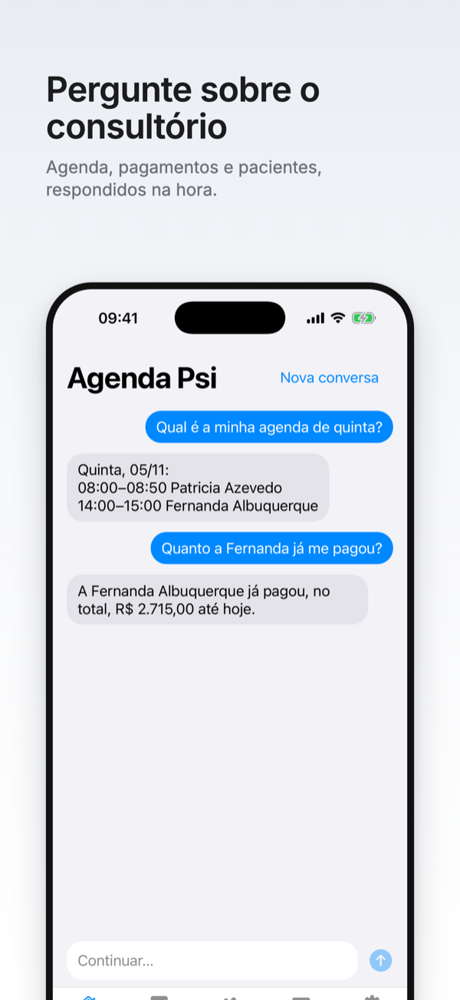
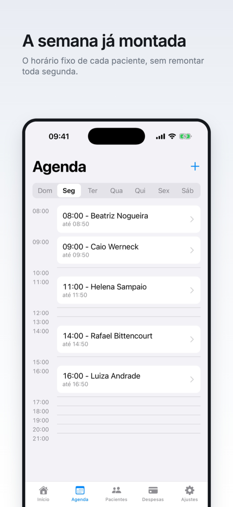
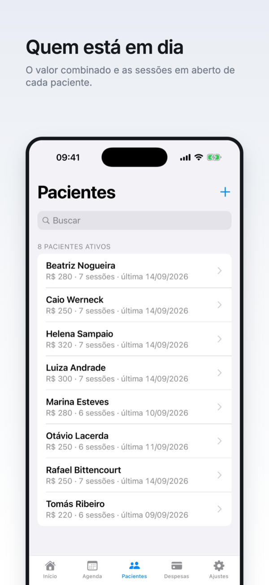
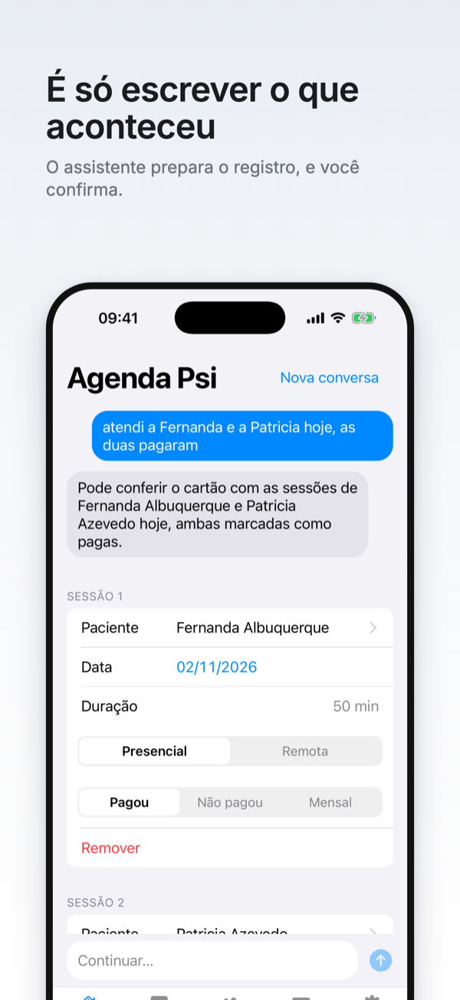
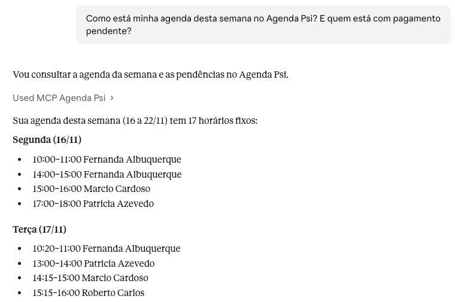
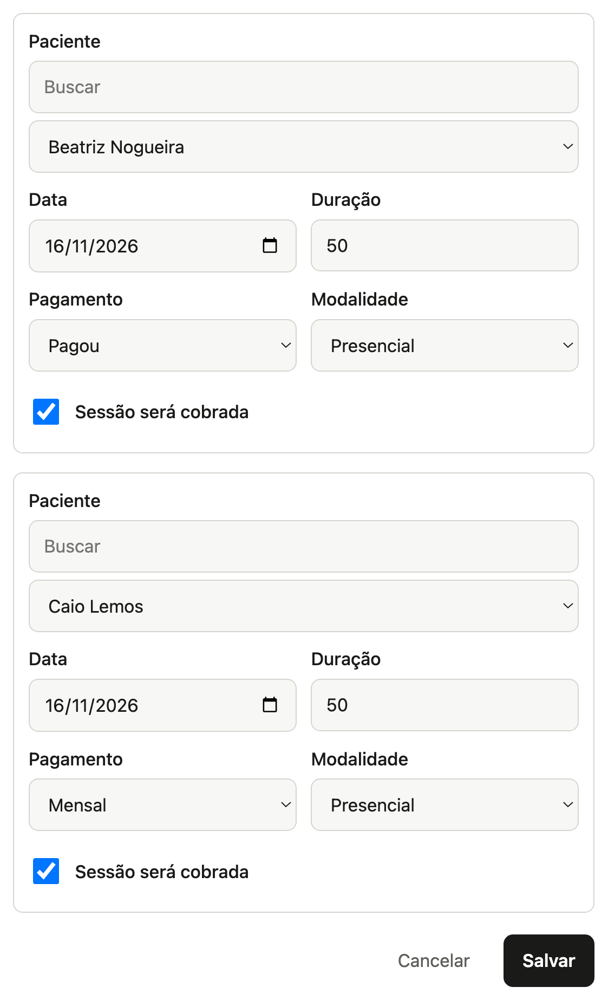
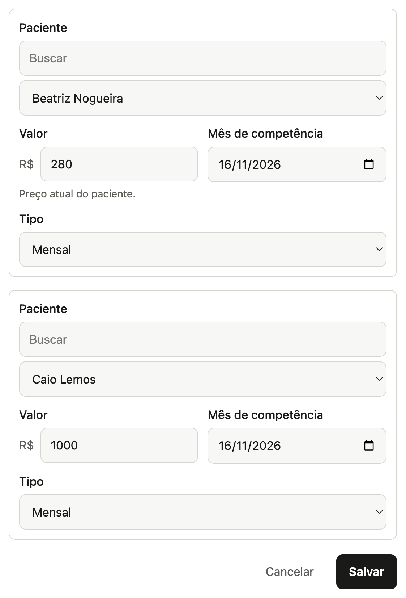
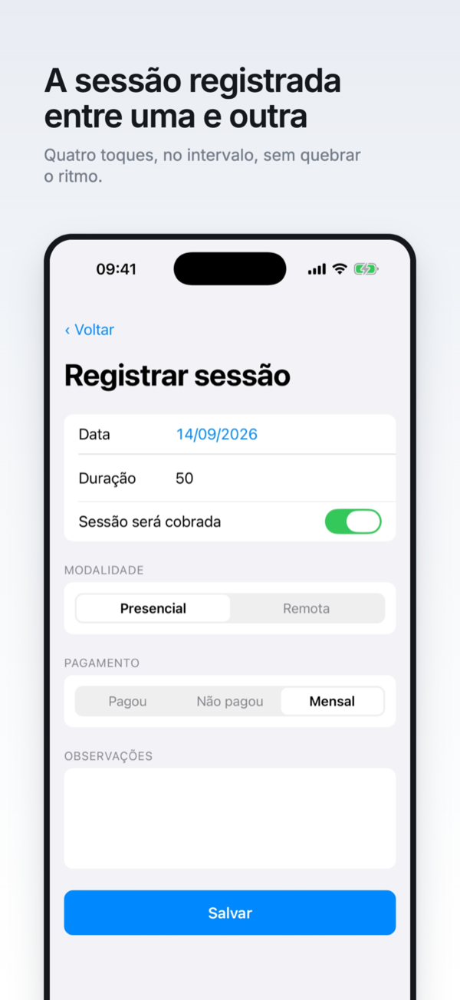
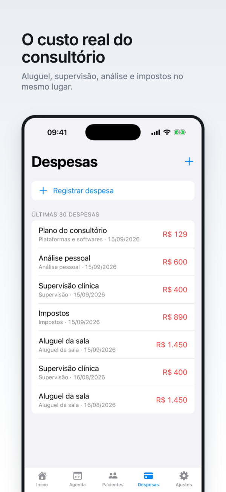

# Agenda Psi

<p align="center">
  
  &nbsp;
  
  &nbsp;
  
</p>

<p align="center">
  <a href="https://app.agendapsi.app.br"><b>app.agendapsi.app.br</b></a> ·
  <a href="mcp-server/CONECTOR.md">Conector para Claude e ChatGPT</a> ·
  <a href="https://app.agendapsi.app.br/privacidade">Privacidade</a>
</p>

O **Agenda Psi** é um app de gestão de agenda e custos do consultório para psicólogos e psicanalistas autônomos: horários fixos da semana, sessões realizadas, pagamentos, preço por paciente, despesas e lembrete por SMS para o paciente. Está na App Store e na Google Play. Não é prontuário eletrônico: o app não guarda registro clínico de sessão.

Dá para usar de três jeitos, com os mesmos dados:

- **Nas telas do app**, no iPhone e no Android.
- **Conversando com o agente, no celular.** É só escrever "atendi a Fernanda hoje e ela pagou" ou "quem ainda não me pagou?". O agente responde na hora as consultas e prepara os registros num cartão, que só é gravado depois que você confere e confirma.
- **Sem abrir o app, pelo Claude, pelo ChatGPT ou por outro assistente compatível com MCP.** O servidor MCP do Agenda Psi conecta a sua conta ao assistente com login OAuth. As perguntas são respondidas na conversa, e toda gravação abre um formulário dentro do chat, que só grava quando você clica em **Salvar**.

É um produto da [Dab Lab](https://www.dablab.com.br/).

## O agente no celular

O Início do app é uma conversa (primeira imagem do topo). O agente consulta a agenda, os pagamentos, as pendências, o mês e o histórico de cada paciente. Para registrar sessão, pagamento, despesa, paciente ou horário, ele monta um cartão com tudo preenchido; você confere, ajusta se precisar e confirma. Paciente com nome parecido nunca é escolhido sozinho, e o agente não apaga paciente.

<p align="center">
  
</p>

A IA só escolhe entre ferramentas prontas: não escreve SQL e não lê as observações dos pacientes. A conversa fica só na memória do aparelho. O plano gratuito tem 10 perguntas por dia; o Pro, 20.

## Headless: pelo Claude, pelo ChatGPT e outros assistentes

O Agenda Psi também funciona sem abrir o app. O servidor MCP em `https://app.agendapsi.app.br/mcp` conecta a conta da pessoa ao Claude (claude.ai, Claude Desktop, Claude Code) e ao ChatGPT, com login OAuth pelo próprio e-mail e senha do Agenda Psi. Cada pessoa só enxerga os próprios dados, garantidos pela RLS do banco.

Pergunte em português, como no app. As consultas respondem na hora:

<p align="center">
  
  &nbsp;
  
</p>

Para gravar, o assistente abre um formulário na conversa, já preenchido com o que você disse. Nada é gravado até você clicar em **Salvar**, e excluir pede um segundo clique. Nos clientes sem formulários, o assistente mostra uma prévia e só grava depois da sua confirmação.

<p align="center">
  
  &nbsp;
  
</p>

São 9 consultas e formulários para sessão, pagamento, despesa, paciente, horário e troca de horário, além da edição e exclusão de cada registro. O conector nunca lê nem envia as observações dos pacientes. Como conectar, os exemplos de pedido e a lista completa estão em [`mcp-server/CONECTOR.md`](mcp-server/CONECTOR.md).

## As telas do app

<p align="center">
  
  &nbsp;
  
</p>

- **Pacientes** com preço por paciente (o histórico de preços é preservado), telefone e e-mail.
- **Sessões** realizadas, presenciais ou remotas, pagas, não pagas ou no mensal.
- **Pagamentos** por sessão ou mensais, e as pendências de cada paciente.
- **Agenda** de horários fixos da semana, com lembrete por SMS para o paciente antes do horário.
- **Despesas** do consultório por tipo e o resumo financeiro do mês.

## Quanto custa

Baixar e usar é grátis, com 10 lembretes por SMS por mês e 10 perguntas por dia ao agente. O **Pro** custa R$ 9,90 por mês, assinado pela App Store ou pela Google Play, e libera SMS ilimitados e mais perguntas ao agente. O conector para Claude e ChatGPT funciona em qualquer plano.

## Stack técnica

- App: Expo SDK 55, React Native 0.83 e TypeScript strict, para iOS e Android
- Supabase: Postgres com RLS em todas as tabelas, views para todo número financeiro e Edge Functions em Deno
- Agente: Edge Function `agente` com Claude e ferramentas só de leitura ou de proposta
- Servidor MCP: MCP SDK com OAuth 2.1 do Supabase, formulários em MCP Apps, hospedado na Vercel (pasta [`mcp-server/`](mcp-server/))
- Assinatura direto nas lojas (`expo-iap`), confirmada pelas notificações da Apple e do Google
- Visão do Produto para os eventos de uso, sem nome de paciente nem valores
- Jest, Vitest e pgTAP para testes

## Como foi construído

Desenvolvido com o Claude (Anthropic) a partir de uma especificação SDD: [`docs/spec.md`](docs/spec.md). O app é a reescrita de uma versão anterior em FlutterFlow, sobre o mesmo banco e os mesmos usuários. O servidor MCP tem spec próprio, em [`mcp-server/spec.md`](mcp-server/spec.md), e foi construído por épicos, cada um conferido por um agente verificador antes do commit.

| Arquivo | O que é |
|---|---|
| [`docs/spec.md`](docs/spec.md) | Especificação do app (fonte única de verdade) |
| [`mcp-server/spec.md`](mcp-server/spec.md) | Especificação do servidor MCP |
| [`DOCUMENTACAO-TECNICA.md`](DOCUMENTACAO-TECNICA.md) | O que está implementado de fato |
| [`CLAUDE.md`](CLAUDE.md) | Guia para sessões do Claude Code neste repositório |
| [`docs/schema.md`](docs/schema.md) | Schema do banco (arquivo gerado) |
| [`docs/decisoes-e-divergencias.md`](docs/decisoes-e-divergencias.md) | Decisões tomadas fora do spec |
| [`mcp-server/CONECTOR.md`](mcp-server/CONECTOR.md) | Documentação pública do conector |

## Contribuições

Issues são bem-vindas: bugs, dúvidas e sugestões. Veja [CONTRIBUTING.md](CONTRIBUTING.md).

---

# Rodar e publicar

## Antes de começar

| Ferramenta | Versão | Para quê |
|---|---|---|
| Node | 22+ | tudo |
| Xcode | 26.1.1 | build de iOS |
| CocoaPods | 1.17+ | idem |
| Docker (colima serve) | qualquer | banco local e `supabase db dump` |
| Supabase CLI | 2.117+ | migrations, tipos, deploy das functions |
| EAS CLI | 22+ | build e submit nas lojas |

⚠️ **A pasta do projeto não pode ter espaço no nome.** O script do React Native
0.83 que baixa dependências pré-compiladas falha em caminho com espaço, e a
mensagem de erro aponta para o lugar errado. Clone em `agenda-psi`, não em
`Agenda Psi`.

---

## Rodando

```bash
cd app
cp .env.example .env      # e preencha, ver abaixo
npm install
npx expo run:ios          # compila e abre no simulador
```

Depois do primeiro build, o ciclo é só `npx expo start` — o dev client já está
instalado e o JavaScript recarrega sozinho.

O app usa **development build**, não Expo Go: o RevenueCat exige módulo nativo.

---

## Variáveis de ambiente

Todas em `app/.env`, e todas `EXPO_PUBLIC_*` — ou seja, **embutidas no bundle e
legíveis por quem abrir o IPA ou o APK**. São públicas por design.

| Variável | O que é | Obrigatória |
|---|---|---|
| `EXPO_PUBLIC_SUPABASE_URL` | URL do projeto | sim |
| `EXPO_PUBLIC_SUPABASE_PUBLISHABLE_KEY` | chave publicável, inútil sem passar pela RLS | sim |
| `EXPO_PUBLIC_VISAODEPRODUTO_URL` | endpoint de ingestão de eventos | não |
| `EXPO_PUBLIC_VISAODEPRODUTO_KEY` | chave de ingestão, só escrita. Sem ela o app roda e não emite evento | não |
(Não há chave de compra: a assinatura é direto nas lojas, pelo `expo-iap`, e
quem autentica é a conta da loja no aparelho.)

**Nenhum segredo de verdade vive aqui.** `service_role`, os segredos do n8n e os
das lojas existem apenas nos secrets das Edge Functions.

Para os builds do EAS, as mesmas variáveis estão cadastradas no projeto
(`eas env:list`), nos três ambientes.

---

## Banco

O schema é versionado em `supabase/migrations` e aplicado **por comando, nunca
pela interface**.

```bash
supabase link --project-ref tocytpjtupbbxwgamtxq
supabase db push --linked          # aplica o que falta em produção
supabase db reset --local          # reconstrói o banco local do zero
supabase test db --local           # roda a suíte pgTAP
```

Depois de qualquer DDL: **rode `get_advisors`**, de segurança e de performance.

Os tipos do TypeScript são gerados do banco real e devem ser regerados a cada
migration:

```bash
supabase gen types typescript --linked > app/src/lib/supabase/database.types.ts
```

### Migrations retidas

Duas existem, estão revisadas e **não** estão em `supabase/migrations`, de
propósito — `db push` aplica tudo que encontra lá. Estão em
[`supabase/migrations-pendentes/`](supabase/migrations-pendentes/README.md), com
a condição de entrada de cada uma.

---

## Edge Functions

Cinco, em `supabase/functions`. As três primeiras substituem webhooks que hoje
rodam **sem autenticação nenhuma**; as duas últimas recebem os avisos de
assinatura de cada loja.

```bash
supabase functions deploy agente-psi
supabase functions deploy analise-financeira
supabase functions deploy notifica-admin
supabase functions deploy apple-notificacoes
supabase functions deploy play-notificacoes
```

Secrets necessários:

```bash
supabase secrets set N8N_AGENTE_URL=... N8N_ANALISE_URL=... N8N_MEAVISA_URL=... \
                     N8N_WEBHOOK_SECRET=... APPLE_BUNDLE_ID=com.dablab.agendapsi \
                     PLAY_PUSH_TOKEN=... PLAY_PACKAGE_NAME=com.dablab.agendapsi \
                     PLAY_SERVICE_ACCOUNT_EMAIL=... PLAY_SERVICE_ACCOUNT_PRIVATE_KEY=...
```

Depois do deploy, cadastre as URLs:

- **Apple:** App Store Connect → App Information → App Store Server
  Notifications V2, produção **e** sandbox, apontando para
  `.../functions/v1/apple-notificacoes`;
- **Google:** Play Console → Monetization setup → tópico Pub/Sub, com push para
  `.../functions/v1/play-notificacoes?token=<PLAY_PUSH_TOKEN>`.

Para verificar tipos das functions sem fazer deploy: `deno check supabase/functions/*/index.ts`.

---

## Testes

```bash
cd app && npx tsc --noEmit    # typecheck
cd app && npx jest            # unitários: formatação, validação, literais do banco
supabase test db --local      # pgTAP: paywall, contador, RLS
```

O teste de RLS autentica como dois psicólogos diferentes e verifica que um não
lê nem escreve dado do outro, **em todas as tabelas**. É o que protege dado de
saúde, e roda sempre.

---

## Build e publicação

```bash
cd app
eas build --profile development --platform ios    # dev client
eas build --profile preview --platform all        # TestFlight e faixa interna
eas build --profile production --platform all
eas submit --profile production --platform ios
```

O app está publicado nas duas lojas com o identificador
`com.dablab.agendapsi`. **Não é primeira publicação em nenhuma das duas** — é
atualização, e a base instalada é preservada.

⚠️ **A atualização desloga todo mundo.** O app anterior guarda a sessão em
`SharedPreferences` e este guarda no Keychain. É por construção, não é defeito.
Avise os usuários ativos antes de publicar.

---

## Licença

O código está aberto para leitura e estudo, nos termos do [LICENSE](LICENSE).

Feito pela [Dab Lab](https://www.dablab.com.br/), product studio de software e IA que constrói apps para pequenas empresas, startups e áreas dentro de grandes empresas, partindo de uma especificação (Spec-Driven Development) e com as disciplinas de engenharia de software robusta.
